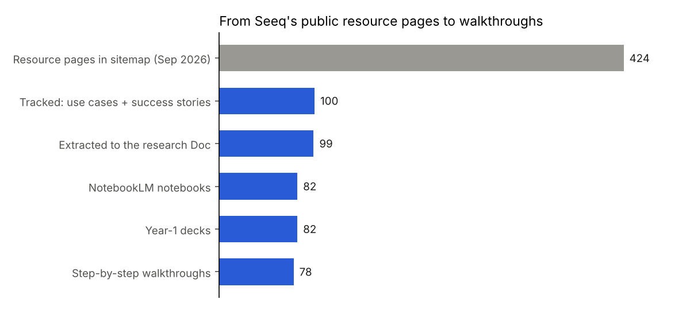
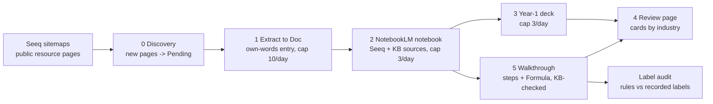
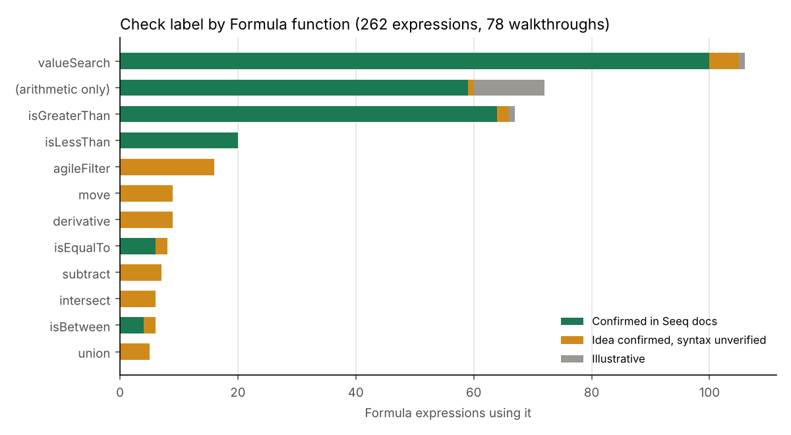
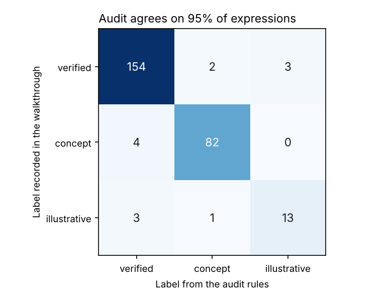

# Seeq use case research pipeline

**Turn Seeq's public library of industrial analytics use cases into a study course: track every page, build a research notebook and a first-year-engineer deck per use case, write a step-by-step "how it is built in Seeq" walkthrough, and check every Formula expression in it against Seeq's own documentation.**




## Problem statement

Seeq publishes hundreds of resource pages: use cases, success stories, webinars and videos. Each says *what* a plant achieved, such as earlier pump failure warnings, golden-batch monitoring or less vented steam. Few say *how* to build it: which tool, which settings, in what order, with what Formula. For an engineer moving from DCS and reliability work into industrial analytics, that "how" is the part worth learning.

Two things make it hard at this scale. The library changes, with new pages appearing every month. And AI-generated explanations of a tool are only useful if their syntax is right, so every generated Formula expression has to be checked against the vendor's documentation, and marked honestly where it can't be confirmed.

## Features

- **Discovery:** reads Seeq's public sitemaps and adds new resource pages to a tracker. It skips draft copies and file links, and never deletes a row.
- **Tracker state machine:** five stages share one sheet, each with a per-run cap, and a stage does nothing when no row is waiting for it.
- **Walkthroughs:** 78 use cases, 652 build steps, each step with its Seeq tool, inputs, settings, output and the reason for it.
- **Formula check labels:** each expression is marked *Confirmed in Seeq docs*, *Idea confirmed, syntax unverified* (concept) or *Illustrative*.
- **Label audit:** a parser and rule set re-derive every label independently and list the disagreements for review.
- **Review page and API:** a self-contained HTML review page, and a FastAPI endpoint to check a new Formula expression against the confirmed syntax.

## Tech stack

| Tool | Used for | Why this one |
|---|---|---|
| Gemini Spark (scheduled agents), Google Sheets, Google Docs | The designed schedules, tracker and research Doc | Spark schedules are stateless, so a shared sheet is the natural place for state |
| NotebookLM | One research notebook per use case, decks, walkthrough questioning | Answers are grounded in, and cited to, the sources loaded into each notebook, including the Seeq Knowledge Base page for each tool |
| Browser agent (Claude) | Seeding, notebooks, decks and walkthroughs, once Spark could not drive NotebookLM | Same tracker, same rules, done step by step under my direction |
| Python, pandas | Discovery, tracker logic, simulation, label audit, review page | The deterministic parts, rebuilt here so they can be tested |
| Regular expressions + a small parser | Reading Seeq Formula expressions into call shapes | Enough to compare syntax across 262 expressions without a Seeq licence |
| Matplotlib, FastAPI, pytest, GitHub Actions | Figures, `/check-formula` endpoint, tests and CI | The course's standard stack |

## Approach



| Stage | Where | Technique | Why this one |
|---|---|---|---|
| Data | `src/data/` | Tracker snapshot, walkthrough store and sitemap snapshot loaders | The real outputs of the run, with private notebook links removed |
| Discovery | `src/discovery/` | Sitemap XML parsing; section from the URL path; skip `-draft` suffix and file links; diff with the tracker | Rules learned from the live sitemap: a `-draft` copy and a PDF link sit beside the real pages, and `induced-draft-fan-maintenance` is a real page, so the match is on the suffix only |
| Tracker | `src/tracker/` | Stage = which rows wait, cap per run, value written back; newest first; day-by-day simulation | Makes the schedule rules testable and shows how long a backlog takes |
| Features | `src/features/` | Tokenizer and parser for Formula: signals, method and function calls, durations, units; each call reduced to a *shape* such as `valueSearch(dur,call)` | Compares syntax, not signal names, across walkthroughs |
| Label audit | `src/models/` | R1 not Formula → illustrative. R2 every call shape confirmed in another walkthrough → confirmed, else concept. R3 plain arithmetic → confirmed unless the numbers look invented | Leave-one-case-out, so an expression can't confirm itself |
| Review page | `src/review/` | One self-contained HTML page; Reviewed tick and notes kept in the reader's browser | Everything for a review round in one file |
| Deployment | `src/api/` | FastAPI `/check-formula`, `/cases`, `/cases/{id}` | Check a new expression before using it |

The original schedule design (times, caps, prompts and what happened when it ran) is in [`docs/spark_schedules.md`](docs/spark_schedules.md).

## Project structure

```
seeq-usecase-research-pipeline/
├── data/
│   ├── raw/             tracker_snapshot.csv, walkthroughs.json, sitemaps/ (snapshot 2026-10-24)
│   ├── processed/       tracker after discovery, schedule simulation, formula audit
│   └── sample/          one walkthrough (pump health monitoring) and 10 tracker rows
├── docs/                spark_schedules.md: the scheduled design and what happened when it ran
├── models/              syntax_registry.json (confirmed call shapes) + model card
├── notebooks/           01_walkthrough.ipynb: every stage with outputs
├── reports/             metrics.json, label_review_list.csv, review_page.html, figures/
├── src/
│   ├── api/             FastAPI service
│   ├── data/            load_data
│   ├── discovery/       sitemap
│   ├── tracker/         stages (state machine, simulation)
│   ├── features/        formula (parser)
│   ├── models/          label_audit
│   ├── review/          page
│   ├── utils/           paths, plots
│   └── pipeline.py      stages wired together
├── tests/               unit and API tests
├── .github/workflows/   CI: tests + full pipeline on every push
├── requirements.txt
├── README.md
└── main.py              runs every stage
```

## How it was validated

1. **Every walkthrough was grounded before it was written.** Each NotebookLM notebook held the use case page, related Seeq pages and the Seeq Knowledge Base page for every tool the walkthrough used: Value Search, Composite Condition, Signal from Condition, Formula, Prediction, Reference Profile and others. Each notebook was asked a fixed set of questions, then for a worked numeric example and common mistakes. Finally it checked its own Formula expressions against the KB, and each expression was labelled from that check.
2. **Labels mean something specific.** *Confirmed in Seeq docs*: the syntax was found in the KB. *Idea confirmed, syntax unverified*: the KB documents the operation, but this exact call wasn't confirmed. *Illustrative*: placeholder values (score weights, fitted coefficients) or not Formula at all. Each walkthrough also lists its assumptions, for example that tag names and limits are placeholders to be set per site.
3. **The labels were audited by a second, independent method:** the rule-based audit in this repo, which uses leave-one-case-out so an expression can't confirm itself. Disagreements go to `reports/label_review_list.csv`.
4. **Discovery was tested on the live sitemap.** Its rules came from what the sitemap actually contains, and a re-run against the October snapshot found the one page published since the September seed.
5. **Unit and API tests** cover the parser, discovery rules, idempotent re-runs, stage caps and idle behaviour, the audit rules and the endpoints.

## Results

| Measure | Result |
|---|---|
| Seeq resource pages in the sitemap | 424 at the September 2026 seed; 433 at the October snapshot |
| Tracked: use cases + success stories | 100 (83 + 17) |
| Extracted to the research Doc | 99 (1 failed) |
| NotebookLM notebooks / Year-1 decks | 82 / 82 |
| Step-by-step walkthroughs | **78**, with 652 build steps |
| Not walked through | 18 skipped (17 success stories, mostly gated downloads, and 1 generic page), 2 duplicates of another use case, 2 covered by a related walkthrough |
| Labelled Formula expressions | 262: **159 confirmed**, 86 concept, 17 illustrative |
| Label audit agreement | **95%** (249 of 262); 13 sent for review |
| Schedule simulation | 83 use cases clear every daily stage in 28 days at the planned caps |



**What the labels show.** The core search syntax, `valueSearch` with `isGreaterThan`, `isLessThan` and similar, was confirmed in the KB again and again. Signal-processing and condition-logic calls, such as `agileFilter`, `move`, `derivative`, `intersect` and `union`, were mostly left at *concept*: the KB documents the operation, but the exact call wasn't confirmed. Plain arithmetic on signals is core Formula; it was marked *illustrative* only where the numbers were invented, such as health-score weights or fitted model coefficients.



**What the 13 disagreements are:**
- **Judgement about values** (6 cases). `0.5 * $baseline * 1.1` was marked *confirmed*, but the rules flag its decimal coefficients. `$predictedLoad + 3` was marked *illustrative* (the 3 is an invented margin), but the rules see only plain arithmetic. Deciding whether a number is invented needs the context, not the syntax.
- **The same call shape labelled concept in one walkthrough and confirmed in another** (3 cases). For example, `valueSearch(2h, isBetween(1, 15), 5s)` is *concept* in one walkthrough while the same shape is *confirmed* elsewhere. These are candidates to upgrade after a second look at the KB.
- **Unusual calls with no confirmed example elsewhere** (4 cases): a `valueSearch` with seven arguments, a percentage threshold, `ln()`, and a power operator. The audit can't confirm them from the other walkthroughs.

A flag is a prompt to recheck, not a verdict: the audit measures consistency between walkthroughs, not correctness against the KB.

## What makes it different

- **It separates "the idea is right" from "the syntax is right".** Most AI-written tutorials don't, and a plant engineer copying an unconfirmed expression into a live workbook is how errors spread.
- **It checks its own labels.** A second, independent method re-derives them, and the disagreements become a review list rather than being hidden.
- **It is honest about the automation.** The schedules were designed for Gemini Spark, and when Spark couldn't drive NotebookLM, the same tracker and rules were run with a browser agent. `docs/spark_schedules.md` records both.

## How to run

```bash
python -m venv .venv && source .venv/bin/activate
pip install -r requirements.txt
python main.py                          # discovery diff, tracker status, simulation, label audit, review page, figures
pytest                                  # unit and API tests
uvicorn src.api.app:app --reload        # API; open http://127.0.0.1:8000/docs
```

Open `reports/review_page.html` in a browser to see every walkthrough. The notebook `notebooks/01_walkthrough.ipynb` shows every stage with its outputs. Everything runs offline on the snapshots in `data/raw/`; no Google, NotebookLM or Seeq account is needed.

## What I learned

- **Put state in one place.** Stateless scheduled agents became reliable once every stage only read and wrote the tracker. That same design let a browser agent take over the stages Spark couldn't do, with nothing lost.
- **Ground first, then generate.** Explanations improved sharply once each notebook held the KB page for every tool it named. Without them, the notebooks described Seeq in general terms.
- **Label uncertainty instead of hiding it.** About 40% of the expressions could not be confirmed in the docs. Saying so is more useful to a learner than a page of confident, unchecked code.
- **Automation has edges.** Seeding from sitemaps beat page scraping, and NotebookLM Studio couldn't be driven by Spark at all. A design should say what happens when a step can't run.

## Data note

**Only public Seeq pages were used.** Walkthroughs and summaries are written in our own words. The Formula expressions are worked examples built for the walkthroughs, with placeholder tag names and limits, as each walkthrough's assumptions state. Private NotebookLM links are removed. No Seeq licence, customer data or employer data was used.

This project is not affiliated with or endorsed by Seeq Corporation; "Seeq" is their trademark. It is a personal study pipeline, not a product, and nothing here has been deployed at a plant.

## Credits

Built with Claude Code; design, requirements and validation by Raja (Rajayoganandha Sekaran).

Licence: MIT (code). Seeq page content belongs to Seeq; this repository links to it and does not reproduce it.
